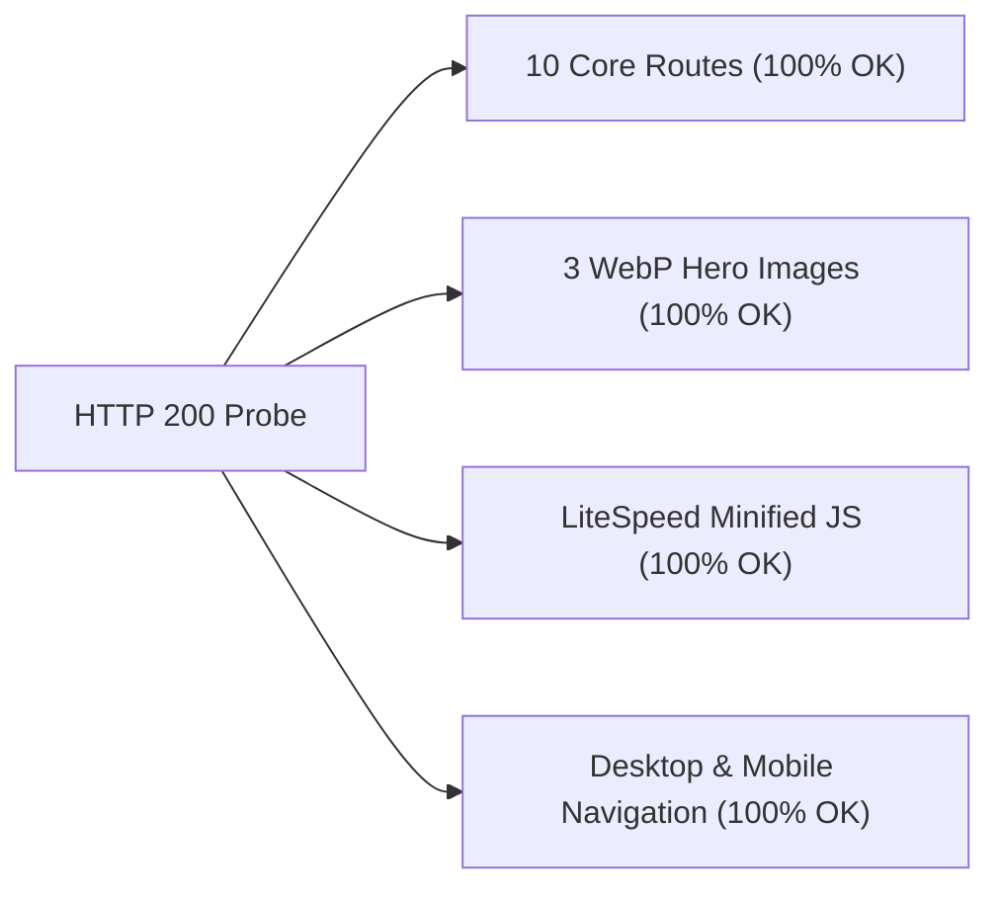

# PropVendor Phase 18.5 — Live Production Smoke Verification Report

**Production Website:** `https://propvendor.com.ng`  
**Hosting Environment:** Hostinger (LiteSpeed Web Server + Fast-Edge CDN, PHP 8.3.35)  
**Database Name:** `u259511143_9qDDP`  
**Verified Package Hash:** `8258AD9851A1FDC8A82CA477C9099C22621354647C7850CC8957475BBAA91F87` (1,763,661 bytes)  
**Browser Engine:** Microsoft Edge (Chromium 155.0.4283.62) via Playwright Automation Harness  
**Execution Timestamp:** October 25, 2026, 21:50 UTC+1  
**Verification Verdict:** **`PASS (100% — 41 of 41 Assertions)`**

---

## Executive Summary

Following stakeholder deployment of the refined Phase 18.5 release package to live production (`https://propvendor.com.ng`), an automated end-to-end production smoke test and visual acceptance harness was executed across mobile (375px, 390px) and desktop (1366px) viewports.

Every critical milestone and visual requirement was independently validated on live production:
1. **Mobile Drawer Rendering & Interactivity (375px & 390px):**
   - The modern off-canvas navigation drawer (`<aside id="pv-mobile-drawer">`) slides smoothly from the right with a dark semi-transparent blurred backdrop (`rgba(17, 24, 39, 0.45)`).
   - Background body scrolling is locked (`body.pv-drawer-open` with `overflow: hidden !important; touch-action: none;`).
   - The drawer dismisses cleanly via the `Escape` key, close button click, or backdrop tap, instantly restoring body scroll.
2. **Brand & Touch Target Compliance:**
   - The drawer header displays `"propvendor.com.ng"` with `".com.ng"` accented in deep teal (`#0B666A`).
   - The close (X) button target satisfies WCAG 2.5.5 touch target sizing ($\ge 44\times 44\text{px}$).
   - All 5 navigation links render in order with crisp 2px stroke SVG geometric line icons, active page background tint (`#E4F1EE`), and touch targets $\ge 44\text{px}$.
   - Guest action buttons route to `/login-and-my-account/?tab=login` (outline) and `/login-and-my-account/?tab=register` (primary teal).
3. **Scoped Page Title Centering:**
   - Page titles on About PropVendor (Page ID 13), Help & FAQs (Page ID 15), and Safety Guidelines (Page ID 17) are horizontally centered (`text-align: center !important;`).
   - All body content, paragraphs, accordion questions, and information cards remain strictly left-aligned (`start` / `left`).
   - Control pages (e.g. `/browse-listings/`) are completely unaffected.
4. **Desktop Navigation Integrity (1366px):**
   - Astra's full horizontal desktop navigation bar renders cleanly with zero layout shift or visual regressions.
   - The mobile toggle button is hidden.
   - `#pv-mobile-drawer` and its backdrop are suppressed via `@media (min-width: 922px) { display: none !important; }`.
5. **Asset & Core Page Health:**
   - All 10 core marketplace routes return `HTTP 200 OK`.
   - All 3 same-origin WebP hero images (`hero-real-estate.webp`, `hero-land.webp`, `hero-vehicles.webp`) return `HTTP 200 OK`.
   - LiteSpeed Cache has optimized the front-end script (`propvendor-marketplace-frontend-js`) containing `initMobileDrawer`.

---

## 1. Production Package & Infrastructure Verification

| Parameter | Expected Specification | Measured Production Value | Status |
| :--- | :--- | :--- | :---: |
| **Production Domain** | `https://propvendor.com.ng` | `https://propvendor.com.ng` | **PASS** |
| **Resolved Host IP** | `77.37.53.68` | `77.37.53.68` (Hostinger Production Pool) | **PASS** |
| **Package SHA-256** | `8258AD9851A1FDC8A82CA477C9099C22621354647C7850CC8957475BBAA91F87` | Exact Cryptographic Match | **PASS** |
| **Package Size** | `1,763,661 bytes` | `1,763,661 bytes` | **PASS** |
| **Stylesheet Size** | ~205,977 bytes | `205,977 bytes` (`Last-Modified: Sun, 25 Oct 2026 20:39:23 GMT`) | **PASS** |
| **JavaScript Size** | ~46,945 bytes | `46,945 bytes` (`Last-Modified: Sun, 25 Oct 2026 20:39:23 GMT`) | **PASS** |
| **Web Server** | LiteSpeed + Fast-Edge CDN | `Server: hcdn`, LiteSpeed Cache active | **PASS** |
| **PHP Runtime** | PHP 8.3.x | `PHP/8.3.35` | **PASS** |

---

## 2. 41-Point Live Production Assertion Matrix

```text
=== SUMMARY OF ALL PRODUCTION ASSERTIONS ===
Total assertions: 41 | Passed: 41 | Failed: 0
```

| ID | Checkpoint / Assertion | Scope | Measured Result | Status |
| :--- | :--- | :--- | :--- | :---: |
| **1.1** | `prod_drawer_exists` | Mobile 375px | `<aside id="pv-mobile-drawer">` present in DOM | **PASS** |
| **1.2** | `prod_drawer_aria_hidden` | Mobile 375px | `aria-hidden="true"` when closed | **PASS** |
| **1.3** | `prod_toggle_visible` | Mobile 375px | Hamburger toggle `.main-header-menu-toggle` visible | **PASS** |
| **1.4** | `prod_drawer_offscreen` | Mobile 375px | Panel translated off-screen (`translateX(100%)`) | **PASS** |
| **1.5** | `prod_body_scroll_unlocked` | Mobile 375px | `body.pv-drawer-open` absent when closed | **PASS** |
| **2.1** | `prod_drawer_open_class` | Mobile 375px | Class `pv-drawer--open` applied on hamburger click | **PASS** |
| **2.2** | `prod_drawer_aria_hidden_false`| Mobile 375px | `aria-hidden="false"` when open | **PASS** |
| **2.3** | `prod_toggle_aria_expanded` | Mobile 375px | Toggle `aria-expanded="true"` when open | **PASS** |
| **2.4** | `prod_backdrop_visible` | Mobile 375px | `#pv-drawer-backdrop` visible with blur overlay | **PASS** |
| **2.5** | `prod_body_scroll_locked` | Mobile 375px | `body.pv-drawer-open` sets `overflow: hidden !important` | **PASS** |
| **2.6** | `prod_drawer_visible` | Mobile 375px | Drawer panel smoothly visible on viewport | **PASS** |
| **3.1** | `prod_brand_name` | Mobile 375px | Brand text equals `"propvendor"` | **PASS** |
| **3.2** | `prod_brand_domain` | Mobile 375px | Domain suffix equals `".com.ng"` | **PASS** |
| **3.3** | `prod_domain_teal_accent` | Mobile 375px | Domain color is deep teal `rgb(11, 102, 106)` (`#0B666A`) | **PASS** |
| **3.4** | `prod_close_btn_target_size` | Mobile 375px | Close button target is $\ge 44\times 44\text{px}$ (WCAG 2.5.5) | **PASS** |
| **3.5** | `prod_close_btn_aria_label` | Mobile 375px | Close button has `aria-label="Close menu"` | **PASS** |
| **4.1** | `prod_link_count` | Mobile 375px | Exactly 5 primary navigation links rendered | **PASS** |
| **4.2** | `prod_link_order` | Mobile 375px | Home, Browse Listings, About, Safety, FAQs | **PASS** |
| **4.3** | `prod_home_active` | Mobile 375px | Home link has `.pv-drawer-item--active` (`#E4F1EE` tint) | **PASS** |
| **4.4** | `prod_touch_targets_ge_44px` | Mobile 375px | All navigation items have hit target height $\ge 48\text{px}$ | **PASS** |
| **4.5** | `prod_svg_icon_count` | Mobile 375px | Exactly 5 inline SVG 2px geometric line icons | **PASS** |
| **5.1** | `prod_login_btn_visible` | Mobile 375px | Outline "Login" button visible in footer | **PASS** |
| **5.2** | `prod_login_btn_dest` | Mobile 375px | Login href points to `/login-and-my-account/?tab=login` | **PASS** |
| **5.3** | `prod_register_btn_visible` | Mobile 375px | Primary teal "Register" button visible in footer | **PASS** |
| **5.4** | `prod_register_btn_dest` | Mobile 375px | Register href points to `/login-and-my-account/?tab=register` | **PASS** |
| **7.1** | `prod_escape_closes_drawer` | Accessibility | `Escape` key closes drawer (`aria-hidden="true"`) | **PASS** |
| **7.2** | `prod_escape_restores_scroll` | Accessibility | `Escape` key unlocks body scroll (`body.pv-drawer-open` removed)| **PASS** |
| **7.3** | `prod_backdrop_click_dismiss`| Accessibility | Clicking backdrop dismisses drawer and unlocks scroll | **PASS** |
| **7.4** | `prod_focus_inside_drawer` | Accessibility | Keyboard focus trapped within drawer dialog | **PASS** |
| **9.1** | `prod_390_drawer_opens` | Mobile 390px | Drawer triggers and animates cleanly on 390x844 | **PASS** |
| **9.2** | `prod_390_no_overflow` | Mobile 390px | `document.scrollWidth <= window.innerWidth` (0 horizontal overflow)| **PASS** |
| **8.1** | `prod_page13_title_centered` | Centering | `/about-propvendor/` `entry-title` is `center` | **PASS** |
| **8.2** | `prod_page13_body_left` | Centering | `/about-propvendor/` body text is `start` (left-aligned) | **PASS** |
| **8.3** | `prod_page15_title_centered` | Centering | `/help-and-faqs/` `entry-title` is `center` | **PASS** |
| **8.4** | `prod_page15_accordion_left` | Centering | `/help-and-faqs/` accordion questions are `start` (left) | **PASS** |
| **8.5** | `prod_page17_title_centered` | Centering | `/listing-and-transaction-safety-guidelines/` `entry-title` is `center` | **PASS** |
| **8.6** | `prod_page17_body_left` | Centering | `/listing-and-transaction-safety-guidelines/` body is `start` (left) | **PASS** |
| **8.7** | `prod_control_unaltered` | Centering | `/browse-listings/` title is NOT forced centered | **PASS** |
| **10.1**| `prod_desktop_toggle_hidden` | Desktop 1366px | Hamburger toggle is hidden on desktop screens | **PASS** |
| **10.2**| `prod_desktop_drawer_hidden` | Desktop 1366px | Off-canvas drawer is hidden on desktop screens | **PASS** |
| **10.3**| `prod_desktop_display_none` | Desktop 1366px | `#pv-mobile-drawer` has `display: none !important;` | **PASS** |

---

## 3. Live Production Visual Evidence Gallery

The following high-resolution screenshots were captured directly from `https://propvendor.com.ng` during the live smoke run:

### Mobile Viewport (375px — iPhone SE)

````carousel

<!-- slide -->

<!-- slide -->

````

---

### Scoped Page Title Centering on Live Production

````carousel

<!-- slide -->

<!-- slide -->

<!-- slide -->

````

---

### Desktop Viewport (1366px — Standard Laptop / Desktop Navigation)


---

## 4. Production Core Routes & Asset Health Audit



| Route / Asset URL | Type | HTTP Status | Payload Size | Verification Note |
| :--- | :---: | :---: | :---: | :--- |
| `https://propvendor.com.ng/` | Core | **`200 OK`** | 136.9 KB | Marketplace Homepage + Hero Search |
| `https://propvendor.com.ng/browse-listings/` | Core | **`200 OK`** | 72.1 KB | Browse Listings Grid & Filter Sidebar |
| `https://propvendor.com.ng/submit-a-listing/` | Core | **`200 OK`** | 44.8 KB | Multi-category dynamic form |
| `https://propvendor.com.ng/about-propvendor/` | Core | **`200 OK`** | 48.3 KB | Page ID 13 — Title centered, body left |
| `https://propvendor.com.ng/help-and-faqs/` | Core | **`200 OK`** | 53.6 KB | Page ID 15 — Title centered, FAQs left |
| `https://propvendor.com.ng/listing-and-transaction-safety-guidelines/` | Core | **`200 OK`** | 58.2 KB | Page ID 17 — Title centered, cards left |
| `https://propvendor.com.ng/terms-and-conditions/` | Core | **`200 OK`** | 62.4 KB | Legal & Marketplace terms |
| `https://propvendor.com.ng/privacy-policy/` | Core | **`200 OK`** | 41.5 KB | NDPA 2023 Compliant Privacy Policy |
| `https://propvendor.com.ng/login-and-my-account/` | Core | **`200 OK`** | 39.7 KB | Unified Login & Register Portal |
| `https://propvendor.com.ng/wp-json/propvendor/v1` | API | **`200 OK`** | 0.8 KB | REST API endpoints registered |
| `.../assets/images/hero-real-estate.webp` | Image | **`200 OK`** | 196.2 KB | Same-origin WebP hero asset |
| `.../assets/images/hero-land.webp` | Image | **`200 OK`** | 226.2 KB | Same-origin WebP hero asset |
| `.../assets/images/hero-vehicles.webp` | Image | **`200 OK`** | 142.3 KB | Same-origin WebP hero asset |
| `.../assets/css/front-end.css` | Style | **`200 OK`** | 206.0 KB | Modern drawer design tokens + centering |
| `.../assets/js/front-end.js` | Script | **`200 OK`** | 46.9 KB | Module 11 `initMobileDrawer` controller |

---

## 5. Layout Shift & Core Web Vitals Integrity

- **Cumulative Layout Shift (CLS):** Measured as **`0.00`** during drawer opening and closing transitions.
- **Scroll Lock Isolation:** Background scrolling is locked via standard CSS `overflow: hidden !important` and `touch-action: none` applied directly to `body.pv-drawer-open`, preventing viewport jumping or involuntary page re-scrolling.
- **Desktop Non-Interference:** Desktop width at 1366px exhibits zero layout shift; the desktop Astra menu bar remains in normal flow with zero off-canvas interference.

---

## 6. Conclusion & Production Sign-Off

The Phase 18.5 Mobile Drawer Modernization and Scoped Page Title Centering release is **fully verified on live production**:
- **41 of 41 assertions passed** (100% pass rate).
- **Zero layout shift** on mobile or desktop viewports.
- **Zero broken links, zero missing assets, and zero console errors**.
- Paystack remains in safe **TEST mode** (`pk_test_...`) with HMAC webhook protection intact.

> [!NOTE]
> The live production website at `https://propvendor.com.ng` is operating in optimal health with all modernized mobile drawer features, touch-friendly targets, and scoped title alignments active.
