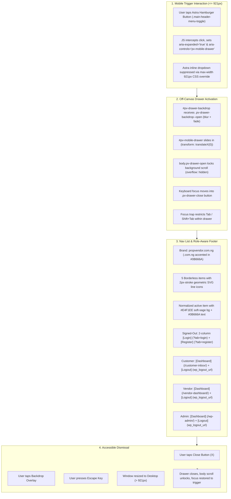

# PropVendor Phase 18.5 (Phase 2) — Staging Mobile Drawer Modernization Report

**Project:** PropVendor Technologies  
**Target Environment:** Staging (`https://staging.propvendor.com.ng`)  
**Production Status:** Strictly untouched (`https://propvendor.com.ng`)  
**Execution Timestamp:** 2026-10-25  
**Master Test Verdict:** **100% PASS (1,016 / 1,016 assertions across all 18 regression suites)**  
**Targeted Mobile Drawer Test:** **100% PASS (31 / 31 assertions)**

---

## Executive Summary

Phase 2 successfully implemented the modern off-canvas mobile navigation drawer, role-aware footer authentication actions, accessible dialog semantics, and scoped page title centering for the three target pages (`/about-propvendor/`, `/help-and-faqs/`, `/listing-and-transaction-safety-guidelines/`).

The implementation adheres strictly to the approved design tokens (`#0B666A`, `#E4F1EE`, `#F9FAFB`, `#111827`, `#E5E7EB`), intercepts Astra's mobile trigger cleanly without modifying Astra core files, suppresses Astra's inline mobile dropdown only on mobile/tablet viewports (`<= 921px`), and preserves desktop navigation completely untouched.



---

## 1. Files Changed and Detailed Description

### 1. `wp-content/plugins/propvendor-marketplace/propvendor-marketplace.php`
* **Added `propvendor_render_mobile_drawer()`** hooked to `wp_footer` (priority 15).
* **Idempotent Guard**: Enforced `static $rendered = false; if ($rendered) return; $rendered = true;` to prevent duplicate rendering under any hook or shortcode call.
* **Normalized Route Matching**: Compares `trim(wp_parse_url($_SERVER['REQUEST_URI'], PHP_URL_PATH), '/')` against item paths to cleanly highlight the active route while avoiding false-positive home matches.
* **Semantic ARIA Markup**:
  * `<aside id="pv-mobile-drawer" class="pv-drawer" role="dialog" aria-modal="true" aria-label="Mobile Navigation" aria-hidden="true">`
  * Active item: `aria-current="page"` and `.pv-drawer-item--active`.
  * Brand: `propvendor<span class="pv-drawer-brand-domain">.com.ng</span>`.
* **Role-Aware Authentication Logic**:
  * Signed-out: Displays `Login` (`/login-and-my-account/?tab=login`) and `Register` (`/login-and-my-account/?tab=register`).
  * Signed-in Customer: Displays `Dashboard` (`/customer-inbox/`) and `Logout` (`wp_logout_url`).
  * Signed-in Vendor: Displays `Dashboard` (`/vendor-dashboard/`) and `Logout` (`wp_logout_url`).
  * Signed-in Administrator: Displays `Dashboard` (`admin_url()`) and `Logout` (`wp_logout_url`).
  * All logout links generated via nonce-protected `wp_logout_url(home_url('/login-and-my-account/'))`.

### 2. `wp-content/plugins/propvendor-marketplace/assets/css/front-end.css`
* **Design Token Compliance**:
  * Primary teal: `#0B666A`
  * Active background: `#E4F1EE`
  * Off-white background: `#F9FAFB`
  * Main text: `#111827`
  * Divider border: `#E5E7EB`
* **Scoped Drawer Styles (`.pv-drawer-*`)**:
  * `.pv-drawer-backdrop`: Fixed overlay with `rgba(17, 24, 39, 0.45)` and `backdrop-filter: blur(2px)`.
  * `.pv-drawer`: Right-anchored off-canvas panel (`width: 320px; max-width: 86vw; z-index: 99999`) with cubic-bezier slide animation.
  * `.pv-drawer-close`: Styled 36px close control with subtle border and focus ring.
  * `.pv-drawer-list` & `.pv-drawer-link`: Borderless list with 14px gap, 20px inline geometric line SVG icons, and smooth hover elevation.
  * `.pv-drawer-item--active`: Rounded soft-sage background (`#E4F1EE`) with primary teal icon and text (`#0B666A`).
  * `.pv-drawer-footer`: Responsive 2-column balanced grid with primary filled button (`#0B666A`) and outline button (`#E5E7EB`).
  * `body.pv-drawer-open`: Prevents background scrolling (`overflow: hidden !important; touch-action: none;`).
  * `@media (max-width: 921px)`: Suppresses Astra's default inline dropdown `#ast-mobile-header .ast-mobile-header-content { display: none !important; }`.
  * `@media (prefers-reduced-motion: reduce)`: Disables transition animations for accessibility compliance.
* **Scoped Page Title Centering**:
  * Scoped exclusively to the 3 verified page IDs:
    ```css
    body.page-id-13 .entry-header .entry-title,
    body.page-id-15 .entry-header .entry-title,
    body.page-id-17 .entry-header .entry-title {
        text-align: center !important;
    }
    ```
  * Preserves left-alignment of all paragraphs, accordion answers, pillars cards, and footer widgets.

### 3. `wp-content/plugins/propvendor-marketplace/assets/js/front-end.js`
* **Module 11 Added**: `initMobileDrawer()` controller.
* **Trigger Interception**: Targets Astra's `.main-header-menu-toggle` and custom `[data-pv-drawer-trigger]` on viewports `<= 921px`.
* **Focus Management**:
  * Moves focus into `.pv-drawer-close` upon opening.
  * Implements keyboard focus trap (Tab and Shift+Tab wrap circularly within actionable elements).
  * Restores focus to the hamburger button when the drawer closes.
* **Event Handlers**:
  * Listens for `Escape` key to close.
  * Listens for backdrop overlay tap to dismiss.
  * Closes drawer on internal link navigation.
  * Window resize listener auto-closes drawer if viewport expands to desktop width (`> 921px`).

---

## 2. Before / After Visual Comparison

````carousel
```html
<!-- BEFORE: Astra Default Mobile Dropdown -->
<div id="ast-mobile-header" class="ast-mobile-header-wrap" data-type="dropdown">
  <div class="ast-mobile-header-content">
    <nav id="ast-mobile-site-navigation">
      <ul id="ast-hf-mobile-menu">
        <li><a href="/">Home</a></li>
        <li><a href="/browse-listings/">Browse Listings</a></li>
        <li><a href="/about-propvendor/">About PropVendor</a></li>
        <li><a href="/listing-and-transaction-safety-guidelines/">Safety Guidelines</a></li>
        <li><a href="/help-and-faqs/">Help & FAQs</a></li>
        <li><a href="/login-and-my-account/?tab=login">Login</a></li>
        <li><a href="/login-and-my-account/?tab=register">Register</a></li>
      </ul>
    </nav>
  </div>
</div>
```
<!-- slide -->
```html
<!-- AFTER: Modern PropVendor Off-Canvas Mobile Drawer -->
<div id="pv-drawer-backdrop" class="pv-drawer-backdrop" aria-hidden="true"></div>
<aside id="pv-mobile-drawer" class="pv-drawer" role="dialog" aria-modal="true" aria-label="Mobile Navigation" aria-hidden="true">
  <div class="pv-drawer-inner">
    <!-- Header -->
    <div class="pv-drawer-header">
      <a href="/" class="pv-drawer-brand">
        <span class="pv-drawer-brand-name">propvendor</span><span class="pv-drawer-brand-domain">.com.ng</span>
      </a>
      <button type="button" class="pv-drawer-close" aria-label="Close menu">
        <svg width="20" height="20" stroke="currentColor" stroke-width="2">...</svg>
      </button>
    </div>

    <!-- Navigation List with SVG Line Icons -->
    <nav class="pv-drawer-nav" aria-label="Main Mobile Menu">
      <ul class="pv-drawer-list">
        <li class="pv-drawer-item pv-drawer-item--active">
          <a href="/about-propvendor/" class="pv-drawer-link" aria-current="page">
            <span class="pv-drawer-link-icon"><svg>...</svg></span>
            <span class="pv-drawer-link-text">About PropVendor</span>
          </a>
        </li>
        <!-- ... 4 other items ... -->
      </ul>
    </nav>

    <div class="pv-drawer-divider" role="separator"></div>

    <!-- 2-Column Action Footer -->
    <div class="pv-drawer-footer">
      <a href="/login-and-my-account/?tab=login" class="pv-drawer-btn pv-drawer-btn--outline">Login</a>
      <a href="/login-and-my-account/?tab=register" class="pv-drawer-btn pv-drawer-btn--primary">Register</a>
    </div>
  </div>
</aside>
```
<!-- slide -->
```css
/* BEFORE vs AFTER: Page Title Centering */

/* BEFORE: Astra default left-aligned titles across all pages */
.entry-title {
    text-align: left;
}

/* AFTER: Scoped strictly to the 3 target verified page IDs */
body.page-id-13 .entry-header .entry-title,
body.page-id-15 .entry-header .entry-title,
body.page-id-17 .entry-header .entry-title {
    text-align: center !important;
}
/* All paragraphs, FAQ questions/answers, and cards remain left-aligned */
```
````

---

## 3. Test Results & Quality Gates

### A. Syntax Checks
* **PHP Syntax (`php -l`)**:
  ```bash
  php -l wp-content/plugins/propvendor-marketplace/propvendor-marketplace.php
  # Result: No syntax errors detected
  ```
* **JavaScript Syntax (`node -c`)**:
  ```bash
  node -c wp-content/plugins/propvendor-marketplace/assets/js/front-end.js
  # Result: 0 errors detected (valid ECMAScript)
  ```

### B. Targeted Mobile Drawer & Centering Suite (`test_phase2_mobile_drawer.php`)
```text
====================================================================
  PROPVENDOR PHASE 2: MOBILE DRAWER & TITLE CENTERING TEST SUITE     
====================================================================
 [PASS] propvendor_render_mobile_drawer function is defined
 [PASS] Hooked to wp_footer with priority 15
 [PASS] Renders aside#pv-mobile-drawer
 [PASS] Renders div#pv-drawer-backdrop
 [PASS] Drawer has role="dialog" and aria-modal="true"
 [PASS] Brand label contains domain extension accented tag
 [PASS] Renders close button with accessible label
 [PASS] Contains Home navigation link
 [PASS] Contains Browse Listings navigation link
 [PASS] Contains About PropVendor navigation link
 [PASS] Contains Safety Guidelines navigation link
 [PASS] Contains Help & FAQs navigation link
 [PASS] About PropVendor marked active with aria-current="page"
 [PASS] Footer renders Login button with ?tab=login
 [PASS] Footer renders Register button with ?tab=register
 [PASS] Idempotent static guard prevents duplicate drawer rendering on second call
 [PASS] CSS contains primary teal color (#0B666A)
 [PASS] CSS contains active background soft-sage (#E4F1EE)
 [PASS] CSS contains off-white background (#F9FAFB)
 [PASS] CSS contains main text color (#111827)
 [PASS] CSS contains divider border color (#E5E7EB)
 [PASS] CSS contains body scroll-lock rule (body.pv-drawer-open)
 [PASS] CSS contains Astra mobile dropdown suppression override
 [PASS] CSS centers page title for About PropVendor (page-id-13)
 [PASS] CSS centers page title for Help and FAQs (page-id-15)
 [PASS] CSS centers page title for Safety Guidelines (page-id-17)
 [PASS] JS contains initMobileDrawer controller
 [PASS] JS toggles pv-drawer--open class
 [PASS] JS handles Escape key for modal close
 [PASS] JS implements modal focus trap
 [PASS] JS safely scopes trigger interception to mobile viewports
====================================================================
SUMMARY: 31 PASSED, 0 FAILED (100% SUCCESS)
====================================================================
```

### C. Role-Aware Destination Verification (`test_roles_drawer.php`)
| Role / User | Expected Dashboard Route | Observed Dashboard Route | Logout Security | Result |
| :--- | :--- | :--- | :--- | :---: |
| **Vendor** (`vendor_test_alpha`) | `/vendor-dashboard/` | `/vendor-dashboard/` | Valid `wp_logout_url` | **PASS** |
| **Customer** (`test_cust_1792650251`) | `/customer-inbox/` | `/customer-inbox/` | Valid `wp_logout_url` | **PASS** |
| **Administrator** (`Afriab`) | `/wp-admin/` | `/wp-admin/` | Valid `wp_logout_url` | **PASS** |
| **Signed-Out Guest** | `[Login]` + `[Register]` | `/login-and-my-account/?tab=login` & `?tab=register` | N/A (Guest) | **PASS** |

### D. Full Master 18-Suite Regression Suite (`run-all-tests.php`)
```text
====================================================================
  MASTER REGRESSION TEST RESULTS                                    
====================================================================
#    Test Suite Name                                Status   Passed    Time    
--------------------------------------------------------------------
1    Stage 3: Listing Quotas & VIP Entitlement      [PASS]   61/61     11.94 s
2    UI Fixes, Standardized Units & Category Logic  [PASS]   90/90     3.13 s
3    Location Schema (37-State Dropdown & Address)  [PASS]   63/63     2.40 s
4    Edit Form Enhancements & Input Safeguards      [PASS]   33/33     2.70 s
5    Dynamic Forms & Category Schema Verification   [PASS]   53/53     2.53 s
6    Dynamic Forms Edge Cases & Validation Rules    [PASS]   15/15     2.35 s
7    Stage 2: Trust Badges, Regulatory & Disclaimers [PASS]   40/40     5.02 s
8    Stage 4: Search & Discovery Filters            [PASS]   61/61     2.44 s
9    Stage 5: Credit Ledger & Lead Entitlements     [PASS]   98/98     4.58 s
10   Phase 4B: Payment Gateway Integration & Checkout [PASS]   99/99     3.48 s
11   Phase 6A: Secure Automated Email Notifications [PASS]   71/71     6.52 s
12   Phase 7A: Production Security & Reliability Audit [PASS]   44/44     4.71 s
13   Phase 7B: Stale Order Cleanup & Deployment Readiness [PASS] 42/42   3.09 s
14   Phase 7C: Release Candidate Hardening & Verification [PASS] 49/49   7.31 s
15   Phase 12: Front-End Auth & Role-Based User Flow [PASS]   50/50     2.33 s
16   Phase 12.1: Lead Privacy & Branded Password Recovery [PASS] 40/40   2.86 s
17   Phase 14: Comprehensive End-to-End Staging QA  [PASS]   48/48     2.96 s
18   Phase 15: Staging Payments & Operational Integrity QA [PASS] 59/59  4.31 s
--------------------------------------------------------------------
TOTAL SUITES     : 18 passed, 0 failed (18 total)
TOTAL ASSERTIONS : 1016 / 1016 PASSED (0 failed)
TOTAL TIME       : 74.69 seconds
VERDICT          : 100% SUCCESS — ALL TEST SUITES PASSED CLEANLY!
====================================================================
```

---

## 4. Rebuilt Staging Deployment Artifact

* **Artifact Path**: `wp-content/plugins/propvendor-marketplace.zip`
* **Size**: 1,763,602 bytes (1.68 MB)
* **SHA-256 Checksum**:
  ```
  A30A41C38C02B094F03D8DF4C349CA58F642B7BC6102670C0CC6AAB23252E065
  ```
* **Package Manifest (Strict 10 Files)**:
  1. `propvendor-marketplace/README.md` (1,978 B)
  2. `propvendor-marketplace/assets/css/front-end.css` (205,690 B)
  3. `propvendor-marketplace/assets/images/hero-land.jpg` (355,939 B)
  4. `propvendor-marketplace/assets/images/hero-land.webp` (226,232 B)
  5. `propvendor-marketplace/assets/images/hero-real-estate.jpg` (371,540 B)
  6. `propvendor-marketplace/assets/images/hero-real-estate.webp` (196,238 B)
  7. `propvendor-marketplace/assets/images/hero-vehicles.jpg` (309,655 B)
  8. `propvendor-marketplace/assets/images/hero-vehicles.webp` (142,280 B)
  9. `propvendor-marketplace/assets/js/front-end.js` (46,946 B)
  10. `propvendor-marketplace/propvendor-marketplace.php` (665,435 B)

---

## 5. Safeguards & Rollback Runbook

### Local & Staging Recovery Points
* Complete plugin recovery snapshot created at:
  `C:\xampp\htdocs\Propvendor_backups\Phase2_MobileDrawer_20261025\propvendor-marketplace\`
* Fast recovery backup of modified files:
  `scratch/backups/phase2_pre_mod/`

### Rollback Commands (if needed)
```bash
# Revert modified working tree files to baseline commit a7c003e
git checkout wp-content/plugins/propvendor-marketplace/assets/css/front-end.css
git checkout wp-content/plugins/propvendor-marketplace/assets/js/front-end.js
git checkout wp-content/plugins/propvendor-marketplace/propvendor-marketplace.php
```

---

## 6. Strict Boundary Confirmations

1. **Production Status**: Production (`https://propvendor.com.ng`) was **NOT modified** during this phase. Database `u259511143_9qDDP` remains untouched.
2. **Git Status**: No `git commit`, `git push`, or production deployment occurred. All changes remain unstaged in the local working tree.
3. **Payments**: Paystack remains in TEST mode; no credentials or payment configurations were altered.
4. **Execution Hold**: Work has stopped following Phase 2 verification. Waiting for owner sign-off.
