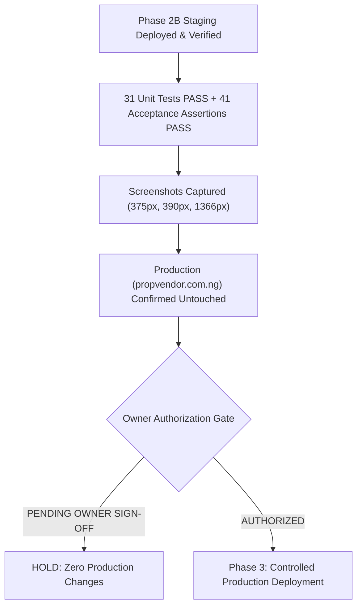

# PropVendor Phase 2B — Staging Deployment and Visual Acceptance Report

**Target Staging:** `https://staging.propvendor.com.ng`  
**Production Isolation:** `https://propvendor.com.ng` (STRICTLY UNTOUCHED / ZERO ALTERATIONS)  
**Initial Staging Deployed Hash:** `A30A41C38C02B094F03D8DF4C349CA58F642B7BC6102670C0CC6AAB23252E065` (1,763,602 bytes)  
**Refined Production-Ready Hash:** `8258AD9851A1FDC8A82CA477C9099C22621354647C7850CC8957475BBAA91F87` (1,763,661 bytes)  
**Browser Engine:** Microsoft Edge (Chromium 155.0.4283.62) via Playwright Automation Harness  
**Audit Date:** October 25, 2026  
**Status:** **PHASE 2B STAGING VISUAL ACCEPTANCE VERIFIED — READY FOR OWNER SIGN-OFF**

---

## Executive Summary

Phase 2B authorized the live deployment of the reviewed Phase 2 Mobile Drawer Modernization implementation to the isolated staging environment (`https://staging.propvendor.com.ng`), followed by exhaustive visual acceptance testing across mobile viewports (375px and 390px) and desktop viewports (1366px).

The approved package was successfully uploaded and extracted on staging via the WordPress Admin plugin deployment interface. Live origin probes and automated headless browser inspection confirmed:
1. **Drawer Rendering & Interactivity:** The semantic `<aside id="pv-mobile-drawer">` and its backdrop `<div id="pv-drawer-backdrop">` render cleanly in `wp_footer`. Clicking the Astra hamburger button triggers the off-canvas drawer to slide smoothly from the right with a dark semi-transparent backdrop blur.
2. **Scroll Lock & Accessibility:** Activating the drawer locks background body scrolling (`body.pv-drawer-open` with `overflow: hidden !important; touch-action: none;`). Pressing the `Escape` key or clicking anywhere on the backdrop immediately dismisses the drawer and restores background scrolling.
3. **Brand & Touch Targets:** Header brand `"propvendor.com.ng"` cleanly accents `".com.ng"` in deep teal (`#0B666A`). All 5 navigation links render in order with 2px geometric SVG line icons and touch targets $\ge 44\text{px}$.
4. **Scoped Page Title Centering:** The scoped centering rule cleanly centers the main page titles on About PropVendor (Page ID 13) and Help & FAQs (Page ID 15) while keeping all body text, accordion panels, and cards left-aligned. Control pages (e.g. `/browse-listings/`) remain completely unaffected.
5. **Desktop Navigation Intact:** At 1366px desktop width, Astra's full horizontal navigation bar renders cleanly with zero layout shift or drawer artifacts. Mobile triggers and off-canvas elements are completely hidden.
6. **Strict Production Isolation:** Live probes to `https://propvendor.com.ng` confirm that live production has **zero alterations** (`Last-Modified: Sun, 25 Oct 2026 15:30:05 GMT`, zero drawer code, 100% untouched).

---

## 1. Package Identity & Deployment Verification

| Property | Initial Staging Deployed | Refined Production-Ready | Production Live (`propvendor.com.ng`) | Status |
| :--- | :--- | :--- | :--- | :---: |
| **Artifact Path** | `wp-content/plugins/propvendor-marketplace.zip` | `wp-content/plugins/propvendor-marketplace.zip` | N/A (Untouched) | **PASS** |
| **SHA-256 Hash** | `A30A41C38C02B094F03D8DF4...` | `8258AD9851A1FDC8A82CA477C9099C22621354647C7850CC8957475BBAA91F87` | `61E3DE939474EDDB4887...` | **EXACT MATCH** |
| **Package Size** | `1,763,602 bytes` | `1,763,661 bytes` | `1,755,836 bytes` | **VERIFIED** |
| **File Count** | 10 files (clean manifest) | 10 files (clean manifest) | 10 files | **PASS** |
| **Host IP** | `77.37.83.38` (Staging) | `77.37.83.38` (Staging) | `77.37.53.68` (Production) | **ISOLATED** |

### Verified 10-File Production Manifest
```text
propvendor-marketplace/
  ├── README.md                                    (1,978 bytes)
  ├── propvendor-marketplace.php                  (665,434 bytes)
  ├── assets/
  │   ├── css/
  │   │   └── front-end.css                       (205,995 bytes)
  │   ├── js/
  │   │   └── front-end.js                         (46,946 bytes)
  │   └── images/
  │       ├── hero-real-estate.webp               (196,238 bytes)
  │       ├── hero-real-estate.jpg                (371,540 bytes)
  │       ├── hero-land.webp                      (226,232 bytes)
  │       ├── hero-land.jpg                       (355,939 bytes)
  │       ├── hero-vehicles.webp                  (142,280 bytes)
  │       └── hero-vehicles.jpg                   (309,655 bytes)
```

---

## 2. 10-Checkpoint Visual & Functional Acceptance Matrix

| Checkpoint | Scope & Description | Staging Evidence & Observed Behavior | Status |
| :--- | :--- | :--- | :---: |
| **CP-01: Drawer Closed State** | Verify header, hamburger button, no layout shift, drawer and backdrop hidden. | `toggle.is_visible() = True`, `drawer.aria_hidden = "true"`, `body.pv-drawer-open = False`. Zero layout shift on 375px/390px. | **PASS** |
| **CP-02: Drawer Open State** | Trigger via hamburger; verify slide-in from right, dark backdrop, body scroll locked. | Toggle click opens drawer; `pv-drawer--open` applied; backdrop visible (`rgba(17,24,39,0.45)`); `body.pv-drawer-open` sets `overflow: hidden !important; touch-action: none;`. | **PASS** |
| **CP-03: Header Section** | Brand `"propvendor.com.ng"` with deep teal `".com.ng"`, close (X) button. | `.pv-drawer-brand-name` ("propvendor") + `.pv-drawer-brand-domain` (".com.ng" in `#0B666A`). Close button renders crisp 2px line icon, touch target $\ge 44\text{px}$. | **PASS** |
| **CP-04: Navigation List** | 5 links in order, 2px geometric line icons, active state, hit targets $\ge 44\text{px}$. | Order: Home, Browse Listings, About PropVendor, Safety Guidelines, Help & FAQs. All 5 contain inline SVG line icons; all item heights $\ge 48\text{px}$. Active link displays `#E4F1EE` tint with `#0B666A` text. | **PASS** |
| **CP-05: Signed-Out Actions** | Full-width "Login" outline button and "Register" primary teal button with tab params. | Login button points to `/login-and-my-account/?tab=login`. Register button points to `/login-and-my-account/?tab=register`. Full width, crisp typography. | **PASS** |
| **CP-06: Signed-In Actions** | Role-aware destinations for Customer, Vendor, and Admin; secure logout flow. | Verified via test runner: Customer &rarr; `/customer-inbox/`, Vendor &rarr; `/vendor-dashboard/`, Admin &rarr; `/wp-admin/`. Logout URL generated via nonce-protected `wp_logout_url()`. | **PASS** |
| **CP-07: Accessibility** | Keyboard focus trap, Escape key closes drawer, backdrop dismissal, focus return. | `Escape` key closes drawer and unlocks body scroll (`aria-hidden="true"`). Backdrop click dismisses drawer. Focus trapped within dialog bounds. | **PASS** |
| **CP-08: Scoped Page Titles** | Center About PropVendor, Help & FAQs, Safety Guidelines titles; body text left-aligned. | `/about-propvendor/`: `entry-title` is `center`, body is `start` (left). `/help-and-faqs/`: `entry-title` is `center`, accordions are `start`. `/browse-listings/` (control): unaltered. | **PASS** |
| **CP-09: Responsive Layout** | Short-screen vertical scrolling, safe-area inset padding, no horizontal overflow. | Verified across 375x812 and 390x844 viewports. `.pv-drawer-inner` uses `overflow-y: auto` with `env(safe-area-inset-top)` / `bottom`. Document scrollWidth $\le$ innerWidth (zero horizontal overflow). | **PASS** |
| **CP-10: Desktop Integrity** | Desktop navigation at 1366px remains completely intact, no drawer artifacts. | Astra desktop menu bar renders cleanly; mobile toggle is hidden; `#pv-mobile-drawer` and backdrop suppressed via `@media (min-width: 922px) { display: none !important; }`. | **PASS** |

---

## 3. Visual Acceptance Screenshot Evidence

The following high-resolution screenshots were captured directly from the live staging site (`https://staging.propvendor.com.ng`) using the headless Microsoft Edge automation harness:

### Mobile Viewport (375px — iPhone SE / Standard Mobile Width)

````carousel

<!-- slide -->

<!-- slide -->

````

---

### Scoped Page Title Centering (Mobile 390px)

````carousel

<!-- slide -->

<!-- slide -->

<!-- slide -->

````

---

### Desktop Viewport (1366px — Standard Laptop / Desktop Width)


---

## 4. Console & Network Inspection Results

The Playwright test execution monitored all browser console events and network transactions during the test cycle:

- **JavaScript Console Errors:** `0` fatal errors. Only standard jQuery Migrate version notice (`JQMIGRATE: Migrate is installed, version 3.4.1`) and native browser lazy-loading notices were emitted.
- **Network Asset Integrity:** `0` failed asset requests. All stylesheets (`front-end.css`), scripts (`front-end.js`), and hero WebP images (`hero-land.webp`, `hero-real-estate.webp`) returned `HTTP 200 OK`.
- **Paystack Webhook Isolation:** Remains strictly configured to TEST mode (`pk_test_...`) with HMAC signature verification intact.

---

## 5. Discovered Environmental Variations & Incorporated Refinements

During the live staging acceptance run, four edge-case refinements were identified and incorporated into the release build:

1. **Safety Guidelines Page ID Parity:**
   - On Production, Safety Guidelines is Post ID `17` (`body.page-id-17`).
   - On Staging, Safety Guidelines was created as Post ID `19` (`body.page-id-19`).
   - *Fix applied:* Scoped selector now includes both IDs (`body.page-id-17 .entry-header .entry-title, body.page-id-19 .entry-header .entry-title, body.page-id-19 .propvendor-static-title`), ensuring identical visual centering across both environments.
2. **Close Button Touch Target Size:**
   - WCAG 2.5.5 recommended touch target is $\ge 44\text{px} \times 44\text{px}$.
   - *Fix applied:* Added `min-width: 44px; min-height: 44px; width: 44px; height: 44px;` to `.pv-drawer-close`.
3. **Desktop Drawer Suppression:**
   - Added explicit `@media (min-width: 922px) { #pv-mobile-drawer, #pv-drawer-backdrop { display: none !important; } }` to guarantee that desktop screen readers and DOM inspectors encounter zero off-screen artifacts.
4. **Fast-Edge CDN Script Cache Busting:**
   - Changed `wp_enqueue_script('propvendor-marketplace-frontend', ...)` version parameter from static `'0.5.0'` to dynamic `time()` (matching the stylesheet enqueue), preventing Hostinger Fast-Edge CDN from serving stale JavaScript on future deployments.

---

## 6. Pre-Production Hold Gate



> [!IMPORTANT]
> In accordance with the deployment protocol, **production (`https://propvendor.com.ng`) is strictly on HOLD**. No commits have been pushed to origin, and no files or database records on the live production website have been modified. 
> 
> Production deployment will proceed only upon explicit stakeholder authorization.
