# PropVendor Phase 19.2 — Stage A: Read-Only Moderation & Onboarding Operational Audit Report

**Document Reference:** `docs/reports/phase-19-2-stage-a-read-only-moderation-onboarding-audit.md`  
**Execution Timestamp:** 2026-10-28T22:45:00+01:00  
**Audit Posture:** Strict READ-ONLY (Zero write mutations to production/staging code or databases)  
**Lead Auditor:** Google DeepMind Advanced Agentic Coding Pair (Antigravity)  
**Target Environments:**  
- **Production:** `https://propvendor.com.ng` (Active, Paystack in TEST mode)  
- **Staging:** `https://staging.propvendor.com.ng` (Active, Paystack in TEST mode)  
- **Local Codebase:** `C:\xampp\htdocs\Propvendor` (Git Branch `main`, Commit `8d9600e` / `514f695`)  
- **Release Archive:** `wp-content/plugins/propvendor-marketplace.zip`  
  - Size: 1,774,972 bytes  
  - SHA-256: `723CF17A0AA6AEA927E41E2D762FC889CAA9562390A6594DE9CF4138D4082F7B`

---

## 1. Executive Summary & Audit Mandate

In accordance with release governance directives, this audit executes **Stage A (Strict Read-Only Production and Codebase Audit)** of **Phase 19.2: Moderation and Onboarding Operations**. The objective is an unsparing, evidence-backed evaluation of the marketplace's listing moderation workflows, vendor onboarding pipelines, access controls, audit governance, notification dispatching, and operational data sanity.

### Summary Verdict
The PropVendor core codebase exhibits strong architectural safeguards for **vendor boundary enforcement**, **REST API write isolation**, and **fail-closed status precedence**. However, **severe operational gaps** exist in moderation observability, rejection feedback, vendor identity verification, and administrative queue management. Most critically, when an administrator rejects a listing or approves it, **no audit trail is recorded**, **no rejection reason is stored or communicated to the vendor**, and **no automated email notification is dispatched**.

Stage B remediation must prioritize these workflows before high-volume commercial vendor onboarding commences.

---

## 2. Verified Environment Baseline & Posture

| Parameter | Production Environment (`propvendor.com.ng`) | Staging Environment (`staging.propvendor.com.ng`) | Local Workspace (`C:\xampp\htdocs\Propvendor`) |
| :--- | :--- | :--- | :--- |
| **HTTP Status** | `200 OK` (TLS v1.3, Valid SSL) | `200 OK` (TLS v1.3, Valid SSL) | Local dev environment |
| **Active Plugin Version** | 1.0.0 (Phase 19.1 active) | 1.0.0 (Phase 19.1 active) | 1.0.0 (With Contact Us CSS polish) |
| **Git Baseline** | Commit `8d9600e` (pushed to origin/main) | Commit `8d9600e` | Commit `8d9600e` (uncommitted CSS polish) |
| **Payment Posture** | **Paystack TEST Mode** (Live unconfigured) | **Paystack TEST Mode** | **Paystack TEST Mode** |
| **Mail Routing** | Authenticated Hostinger SMTP (`ssl://smtp.hostinger.com:465`) | Authenticated Hostinger SMTP (`ssl://smtp.hostinger.com:465`) | Mock transport in unit tests |
| **Support Mailboxes** | Active: `support@`, `safety@`, `privacy@`, `noreply@` | Active: `support@`, `safety@`, `privacy@`, `noreply@` | N/A |
| **Dead Domain (.ng)** | 0 occurrences in source, 0 NXDOMAIN lookups | 0 occurrences in source, 0 NXDOMAIN lookups | 0 occurrences in source |
| **Database Mutations** | **0 writes / 0 schema edits executed** | **0 writes / 0 schema edits executed** | **0 writes executed during audit** |

---

## 3. Deep Architectural Inspection by Domain

### Domain A: Listing Moderation Workflow

#### Status Taxonomy & Precedence
The platform defines 7 canonical moderation statuses via `propvendor_marketplace_get_listing_status_choices()` (Line 17):
1. `Pending review` (Default for initial submission and vendor edits)
2. `Published` (Approved by admin; public on marketplace)
3. `Rejected` (Declined by admin; marked as `draft` in WP core)
4. `Sold` (Transaction closed; inactive marker)
5. `Rented` (Transaction closed; inactive marker)
6. `Unavailable` (Temporarily withdrawn; inactive marker)
7. `Expired` (Time-bounded listing elapsed; inactive marker)

#### Fail-Closed Status Resolution
The canonical status resolver `propvendor_marketplace_get_canonical_listing_status($post_id)` (Lines 73–120) enforces fail-closed logic:
- If either `propvendor_listing_status` or fallback `propvendor_status` contains an inactive marker (`'Rejected'`, `'Unavailable'`, `'Expired'`, `'Sold'`, `'Rented'`), that inactive marker **unconditionally supersedes** any other post state.
- Inactive listings cannot inadvertently occupy active vendor quota slots or appear in browse queries.

#### Self-Approval Prevention & Vendor Edit Traps
In `propvendor_marketplace_process_listing_submission()` (Lines 6411–6650):
- Initial submissions are hardcoded to `$post_status = 'pending'` and `$listing_status = 'Pending review'`.
- Vendor edits to an already `Published` listing explicitly trigger status demotion:
  ```php
  if ($existing_post_id > 0) {
      $existing_status = get_post_status($existing_post_id);
      if ('publish' === $existing_status) {
          $post_status = 'pending';
          $listing_status = 'Pending review';
      }
  }
  ```
- **Strengths:** Vendors cannot self-approve or smuggle unauthorized modifications into a published listing without administrator re-moderation.
- **Critical Gap:** The vendor receives no warning that minor textual edits return their listing to the moderation queue, temporarily delisting it from the public marketplace.

#### Rejection Handling Deficiencies
- When an admin selects `Rejected` in the post moderation meta box (`propvendor_marketplace_handle_admin_moderation_save()`, Lines 7216–7290), the post status is set to `draft` and meta updated to `Rejected`.
- **Defects:**
  1. The meta box provides **zero input fields** for entering a rejection reason or feedback notes.
  2. No meta key exists (e.g. `_propvendor_rejection_reason` or `_propvendor_rejection_notes`).
  3. The vendor dashboard displays "Rejected" without explaining why (e.g., blurry photos, unverified title, price mismatch) or providing remediation steps.

---

### Domain B: Vendor Onboarding & Identity Verification

#### Registration Flow & Capability Assignment
In `propvendor_marketplace_handle_user_register()` (Lines 5535–5645):
- Registration is rate-limited to 3 registrations per hour per IP.
- Allows account type selection: `customer` or `vendor`.
- For `vendor`:
  - Captures `business_name`, `phone_number`, `business_type`, and optional `verification_details`.
  - Creates user with role `vendor`.
  - Dynamically grants capability `propvendor_submit_marketplace_listings`.
  - Automatically logs the vendor in (`wp_set_auth_cookie`) and redirects immediately to `/vendor-dashboard/`.

#### Quota & Race-Condition Safeguards
- Free vendor accounts receive a hard limit of **3 active listings** (`PROPVENDOR_FREE_LISTING_LIMIT = 3`).
- Submissions enforce atomic concurrency control via MySQL session-level lock `GET_LOCK('pv_listing_quota_{owner_id}', 10)` to eliminate parallel race-condition bypass.

#### Identity Verification Gaps
- **Zero Email Verification:** Vendors are logged in and authorized immediately upon registration without confirming mailbox ownership.
- **Zero Phone / OTP Verification:** No SMS or WhatsApp OTP verification is performed; arbitrary phone numbers can be registered.
- **Zero Document KYC / NIN / CAC Requirement:** Business registration (CAC RC/BN number) and National Identification Number (NIN) are neither validated nor required before listing creation.
- **Regulatory Verification (LASRERA):**
  - Lines 7842–7937 provide an admin profile toggle for `propvendor_regulatory_verified` and field `propvendor_lasrera_number`.
  - If approved by an admin, the vendor receives a public "State Regulatory Verified" badge.
  - However, this is purely optional and post-hoc; unverified vendors can immediately publish up to 3 listings pending moderation.

---

### Domain C: Permissions, Capabilities & Trust Controls

#### Capability Matrix & Isolation

| Operation | Required Capability | Implementation Reference | Enforcement Posture |
| :--- | :--- | :--- | :--- |
| **Submit / Edit Listing (Frontend)** | `propvendor_submit_marketplace_listings` | Lines 6430–6436 | Strict capability check |
| **REST API Listing Write (POST/PUT)** | `manage_options` (Admin only) | Lines 1047–1056 | **403 Forbidden** for non-admins |
| **Approve / Reject Listing** | `manage_options` (Admin only) | Lines 7163, 7225 | Strict admin check + CSRF nonce |
| **Access WP Admin (`/wp-admin/`)** | Non-vendor roles | Lines 1153–1180 | **Redirects to `/vendor-dashboard/`** |
| **Toggle LASRERA Verification** | `manage_options` (Admin only) | Lines 7855–7940 | Admin profile screen only |
| **Contact Unlock & Lead Privacy** | 1 Credit Balance + Auth | Lines 10240–10450 | Backend credit deduction + masking |

#### Architectural Protections
1. **WP Admin Lockdown:** Vendors attempting to access any `/wp-admin/` URL (other than allowed `admin-post.php` handlers) are forcefully intercepted by `propvendor_marketplace_restrict_vendor_admin_access()` and redirected to `/vendor-dashboard/`.
2. **REST API Lockdown:** The REST API endpoints for `property_listing`, `land_listing`, and `vehicle_listing` strictly reject vendor direct writes with HTTP 403 Forbidden. Vendors can only submit through the vetted `admin-post.php` pipeline where data validation, file sanitation, and quota locks are guaranteed.
3. **Contact Information Masking:** Direct phone numbers and email addresses of prospective buyers and vendors are hidden behind the credit-unlock barrier to prevent off-platform bypass and customer poaching.

---

### Domain D: Moderation Audit Trail & Governance

#### Comparative Assessment: Contact Reports vs. Listings

| Governance Feature | Phase 19.1 Contact & Safety Reports (`pv_wp_propvendor_contact_reports`) | Core Marketplace Listings (`property_listing`, `land_listing`, etc.) |
| :--- | :--- | :--- |
| **Persistent Table** | Dedicated table with InnoDB row locking | Standard WP `posts` + `postmeta` tables |
| **Audit Trail Storage** | Structured JSON array in `audit_trail` column | **NONE (Zero audit trail stored)** |
| **Admin Actor Attribution** | Stores `user_id`, `admin_user`, `admin_name` on transitions | **NONE (Acting admin user ID is discarded)** |
| **Timestamping** | Microsecond `timestamp` recorded on all status changes | Relies solely on WP post modified timestamp |
| **Historical Reason Retention**| Triage notes and status changes preserved in sequence | **NONE (Overwritten in place; no history)** |
| **Ticket Reference Tracking** | Deterministic collision-proof `TKT-XXXXXX` | Standard numeric WP Post ID |

#### Governance Risks
- Because listings have no audit log, if an admin incorrectly approves or rejects a listing, there is **zero forensic record** indicating which administrator performed the action, at what time, or with what reasoning.
- If a listing is rejected multiple times during a resubmission cycle, previous moderation decisions and administrative comments are entirely lost.

---

### Domain E: Notifications & Admin Operations

#### Notification Dispatcher Analysis
The plugin includes an enterprise-grade notification subsystem (`propvendor_marketplace_dispatch_notification()`, Lines 12258–12350) equipped with:
- Idempotency via unique `event_key` hashing.
- Deduplication and retry guards in `{prefix}propvendor_notifications`.
- User opt-out preference enforcement.
- Authenticated Hostinger SMTP transport.

#### The Moderation Blackout
Despite this sophisticated infrastructure, the notification dispatcher is **only wired to two events**:
1. `new_enquiry` (Customer submits enquiry &rarr; Vendor notified).
2. `vendor_reply` (Vendor replies to customer &rarr; Customer notified).

**Moderation Event Coverage is 0%:**
- **On Listing Submitted:** Administrator receives **no email notification** that a listing is pending review.
- **On Listing Approved:** Vendor receives **no email notification** confirming that their listing is now live.
- **On Listing Rejected:** Vendor receives **no email notification** informing them of rejection or outlining required fixes.
- **On Vendor Registration:** Administrator receives **no notification** of new vendor onboarding.

#### Administrative Queue Deficiencies
- There is **no unified Moderation Queue page** in WP Admin.
- To moderate listings, administrators must navigate separately to:
  - `wp-admin/edit.php?post_type=property_listing`
  - `wp-admin/edit.php?post_type=land_listing`
  - `wp-admin/edit.php?post_type=vehicle_listing`
- There is no aggregate badge or dashboard counter displaying pending listing counts across all categories.

---

### Domain F: Operational Baseline & Data Sanity

#### REST API Inventory Audit (Live Probe)

```
=== PRODUCTION REST PROBE (https://propvendor.com.ng) ===
property_listing : Total=0 published
land_listing     : Total=0 published
vehicle_listing  : Total=0 published
vendor_profile   : Total=0 published
users            : Total=1 (Admin: afriab_admin)
pages            : Total=17
posts            : Total=1

=== STAGING REST PROBE (https://staging.propvendor.com.ng) ===
property_listing : Total=2 published
  -> ID 353: "Stunning 4 Bedroom Duplex Lekki" (slug: stunning-4-bedroom-duplex-lekki-2)
  -> ID 351: "Stunning 4 Bedroom Duplex Lekki" (slug: stunning-4-bedroom-duplex-lekki)
land_listing     : Total=0 published
vehicle_listing  : Total=0 published
users            : Total=2 (Admin + Staging Test Vendor)
pages            : Total=17
posts            : Total=1
```

#### Production Browse Verification
- Navigating to `https://propvendor.com.ng/browse-listings/` displays:
  `<p class="propvendor-results-count" role="status">0 matching listings</p>`
  `<p class="propvendor-empty">No listings match your search criteria...</p>`
- **Sanity Finding:** Production has zero published listings, ensuring that no unmoderated, test, or synthetic mock listings are exposed to live buyers.
- **Payment Verification:** Paystack integration on both production and staging is active in **TEST mode** (`pk_test_...` / `sk_test_...`). Live payment processing has not been activated.

---

## 4. Current vs. Target Workflow State Diagram

```mermaid
flowchart TD
    subgraph Current_State["Current State (Phase 19.1)"]
        subgraph V1["Vendor Actions"]
            Reg1["Register Vendor"] --> AutoLogin1["Instant Auto-Login\n(No Email/Phone Verify)"]
            AutoLogin1 --> Sub1["Submit Listing\n(Quota: 3 Active)"]
        end
        subgraph M1["Moderation & Storage"]
            Sub1 --> Pend1["post_status = pending\npropvendor_listing_status = Pending review"]
            Pend1 -.-> AdminManual1["Admin checks 3 separate WP menus\n(Zero notifications)"]
            AdminManual1 --> Decision1{"Admin Decision"}
            Decision1 -->|Approve| Pub1["Status: Published\n(No vendor email)"]
            Decision1 -->|Reject| Rej1["Status: Rejected (Draft)\n(No reason stored, no email)"]
        end
    end

    subgraph Target_State["Target Stage B Implementation"]
        subgraph V2["Vendor Pipeline"]
            Reg2["Register Vendor"] --> Onboard2["Email Verification / Welcome Notice\n+ Optional Identity Badging"]
            Onboard2 --> Sub2["Submit Listing\n(Atomic Quota Check)"]
        end
        subgraph M2["Automated Queue & Governance"]
            Sub2 --> Pend2["Status: Pending Review\n+ Audit Log Entry"]
            Pend2 ==> NotifAdmin["Dispatch Notification:\nNew Listing Awaiting Moderation"]
            NotifAdmin --> Queue2["Dedicated WP Admin Moderation Queue\n(Unified across Properties, Land, Vehicles)"]
            Queue2 --> Decision2{"Admin Review"}
            Decision2 -->|Approve| Pub2["Status: Published\n+ Audit Log (Admin ID + Time)"]
            Pub2 ==> NotifVendorApp["Dispatch Notification:\nListing Approved & Live!"]
            Decision2 -->|Reject| Rej2["Status: Rejected\n+ Rejection Reason Code & Notes\n+ Audit Log (Admin ID + Time)"]
            Rej2 ==> NotifVendorRej["Dispatch Notification:\nListing Needs Correction + Reason"]
            NotifVendorRej --> DashRej["Vendor Dashboard:\nDisplays Rejection Reason + Resubmit Button"]
        end
    end

    classDef current fill:#fef2f2,stroke:#ef4444,stroke-width:1px;
    classDef target fill:#f0fdf4,stroke:#10b981,stroke-width:1px;
    class Current_State current;
    class Target_State target;
```



---

## 5. Findings Register

| ID | Domain | Severity | Verdict | Finding Description | Remediation Plan |
| :--- | :--- | :--- | :--- | :--- | :--- |
| **F-01** | Domain D (Audit) | **CRITICAL** | **GAP** | **No moderation audit trail on listings:** Listing status changes do not record admin user ID, timestamp, prior status, or notes. | Implement structured JSON audit log in listing postmeta or custom log table. |
| **F-02** | Domain A (Workflow) | **CRITICAL** | **GAP** | **No rejection reason field or storage:** Administrators cannot provide rejection reasons; vendors receive no feedback. | Add `rejection_reason` enum and custom feedback text box to admin meta box and store in postmeta. |
| **F-03** | Domain E (Notif) | **HIGH** | **GAP** | **Zero moderation notifications:** Submissions, approvals, and rejections trigger no emails to admins or vendors. | Hook `propvendor_marketplace_dispatch_notification()` into moderation save and listing submission handlers. |
| **F-04** | Domain E (Admin) | **MEDIUM** | **GAP** | **No unified Moderation Queue:** Admins must hunt through 3 separate CPT post tables to find pending listings. | Create dedicated admin submenu `Marketplace Moderation` with aggregate counts and one-click review. |
| **F-05** | Domain B (Onboard) | **HIGH** | **RISK** | **Zero email/phone verification for vendors:** New vendor accounts have immediate listing creation capabilities without verified contacts. | Add vendor email verification check before allowing listing submission. |
| **F-06** | Domain B (Onboard) | **MEDIUM** | **PASS** | **Atomic listing quota enforcement:** Free tier limit (3 active listings) is robustly locked via MySQL `GET_LOCK`. | Maintain existing logic; ensure reactivation checks remain under lock. |
| **F-07** | Domain C (Access) | **LOW** | **PASS** | **Strict vendor WP Admin lockdown & REST write isolation:** Vendors are blocked from `/wp-admin/` and cannot post via REST. | Maintain existing architecture; 100% compliant. |
| **F-08** | Domain A (Workflow) | **MEDIUM** | **PASS** | **Vendor edit demotion safeguard:** Approved listings return to pending status upon vendor update to prevent smuggling. | Maintain demotion, but add explanatory UI warning banner on vendor edit form. |
| **F-09** | Domain F (Sanity) | **LOW** | **PASS** | **Production catalog hygiene & Paystack TEST mode:** Production has 0 mock listings; Paystack strictly in TEST mode. | Verified safe for ongoing development. |

---

## 6. Prioritized Backlog for Stage B

### Priority 1: Governance & Observability (Critical)
1. **Rejection Reason Architecture:**
   - Define canonical rejection reasons: `Incomplete Address`, `Low Quality / Inadequate Images`, `Unrealistic / Inaccurate Price`, `Unverified Title Claim`, `Duplicate Listing`, `Prohibited Content / Policy Violation`, `Other (Specific Notes Required)`.
   - Add rejection fields to `propvendor_marketplace_render_moderation_meta_box()`.
   - Store reason code and admin comments in `_propvendor_rejection_reason` and `_propvendor_rejection_notes`.
2. **Listing Audit Trail:**
   - Implement `_propvendor_moderation_audit_trail` postmeta storing chronological records:
     `{"timestamp": "...", "admin_id": 1, "admin_name": "afriab_admin", "from_status": "Pending review", "to_status": "Published", "reason": "...", "notes": "..."}`.

### Priority 2: Automated Notification Hooks (High)
1. **Admin Notification on Listing Submission:**
   - Event key: `listing_submitted:{listing_id}:{timestamp}`
   - Recipient: Site Admin / Moderation Team (`support@propvendor.com.ng`)
   - Content: Vendor name, listing title, category, direct link to WP Admin moderation screen.
2. **Vendor Notification on Listing Approval:**
   - Event key: `listing_approved:{listing_id}`
   - Recipient: Listing author email
   - Content: Congratulatory email, public listing URL, share guidance.
3. **Vendor Notification on Listing Rejection:**
   - Event key: `listing_rejected:{listing_id}`
   - Recipient: Listing author email
   - Content: Clear statement of rejection, reason code, admin feedback, and link to edit and resubmit.

### Priority 3: Administrative Operations UI (Medium)
1. **Unified Moderation Queue Dashboard:**
   - Add admin submenu: **Marketplace &rarr; Moderation Queue** (`propvendor-moderation-queue`).
   - Unified tabular display of all `property_listing`, `land_listing`, and `vehicle_listing` posts with status `pending`.
   - Shows thumbnail, title, category, state, price, vendor name, submission date, and direct action buttons (Review, Quick Approve, Reject).

---

## 7. Stage B Implementation & Rollback Architecture Plan

### Affected Files
- `wp-content/plugins/propvendor-marketplace/propvendor-marketplace.php`:
  - Enhance `propvendor_marketplace_render_moderation_meta_box()` and `propvendor_marketplace_handle_admin_moderation_save()`.
  - Add notification hooks in `propvendor_marketplace_process_listing_submission()`.
  - Register `propvendor-moderation-queue` admin page.
- `wp-content/plugins/propvendor-marketplace/assets/css/front-end.css`:
  - Vendor dashboard rejection badge and feedback styling.
- New test suite: `tests/test_phase19_2_moderation_and_onboarding.php`.

### Staging Acceptance Testing Gates
1. Unit test suite asserting 100% pass on status transitions, rejection metadata, audit log structure, and notification dispatch arguments.
2. Staging browser verification:
   - Vendor submits listing &rarr; Verify listing is `pending`, admin receives notification.
   - Admin approves listing &rarr; Verify audit log entry, vendor receives approval email.
   - Vendor edits listing &rarr; Verify status returns to `pending`.
   - Admin rejects listing with reason &rarr; Verify rejection reason stored in meta, audit trail logged, vendor receives rejection email with reason.
   - Vendor dashboard reflects rejection reason and allows remediation.

### Rollback Strategy
- Database changes are purely additive (new postmeta keys `_propvendor_rejection_reason`, `_propvendor_moderation_audit_trail`).
- Zero schema breaking changes.
- Rollback can be executed instantaneously by re-deploying the Phase 19.1 release archive (`57C944385CB17AD2C067C63463B31A1200AE1BE023018080BEF87E298BF3D193`).

---

## 8. Strict Read-Only Certification

I hereby certify that during the execution of Phase 19.2 Stage A:
1. **Zero write mutations** were made to the production or staging databases.
2. **Zero listings** were created, modified, approved, or deleted on production or staging.
3. **Zero user accounts** were created or modified on production or staging.
4. **Paystack payment gateway** remains strictly in **TEST mode** across all environments.
5. All tests and audit probes executed were purely passive reads or local mock tests.

**Report Status:** COMPLETE & FROZEN FOR STAGE B AUTHORIZATION.
